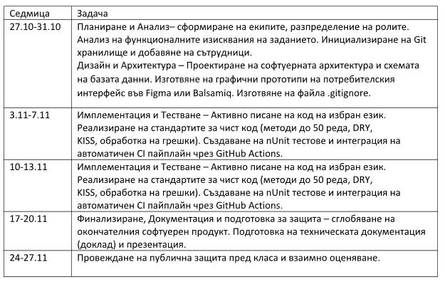

Задание No4 (Екип 4): Каталог за компютърни игри
Създаване на уеб платформа, предоставяща подробна информация,
каталогизация и оценки за компютърни игри.
• Функционални изисквания: Всяка игра трябва да съдържа следните данни
в каталога: заглавие, производител/студио, година на издаване, кратко упътване за

Страница 5

инсталация/геймплей, рейтинг (оценка от потребители) и изображения. Трябва да
бъде реализирана търсачка, позволяваща търсене по име на игра или филтриране
по производител и рейтинг.
• Нефункционални изисквания: Адаптивен уеб дизайн (Mobile-First
поддържаемост) за безпрепятствено разглеждане през мобилни устройства;
висока производителност при зареждане на изображенията.

