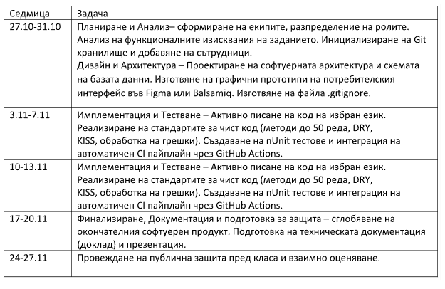

markdown
# 🎮 Каталог за компютърни игри (Задание No4 - Екип 4)

Уеб платформа, предоставяща подробна информация, каталогизация и оценки за компютърни игри.

## 📝 Описание на заданието
Проектът покрива всички изисквания на Задание No4:
* **Функционални:** Всяка игра съдържа заглавие, студио, година, упътване, рейтинг и изображение. Реализирана е търсачка по име, както и филтриране по производител и минимален рейтинг.
* **Нефункционални:** Напълно адаптивен (Mobile-First) дизайн чрез CSS Grid. Оптимизирано зареждане на изображенията чрез lazy loading (`loading="lazy"`).

## 🛠 Технологичен стек (KISS Методология)
* **База данни:** MySQL 8.0 (в Docker контейнер)
* **Backend:** Node.js + Express + `mysql2`
* **Frontend:** Vanilla JavaScript, HTML5, CSS3
* **Инфраструктура:** Docker Compose + Adminer (за управление на БД)

## 🚀 Как да стартирате проекта локално?

1. **Стартиране на базата данни и Adminer:**
   ```bash
   docker compose up -d
(Базата данни автоматично се инициализира с примерни данни от db/init.sql)

## Стартиране на Backend сървъра:
```bash 
    cd backend
    npm install
    node server.js
```
Важно: Сървърът ще работи на http://localhost:3000

## Стартиране на Frontend:
### Отворете нов терминал и изпълнете:
```bash
    npx serve frontend
```

Важно: (Отворете генерирания линк в браузъра)


# 📂 Структура на проекта
/db – SQL скриптове за инициализация

/backend – Node.js сървър и API рутиране

/frontend – HTML, CSS и JS за потребителския интерфейс

docker-compose.yml – Конфигурация за Docker контейнерите

 