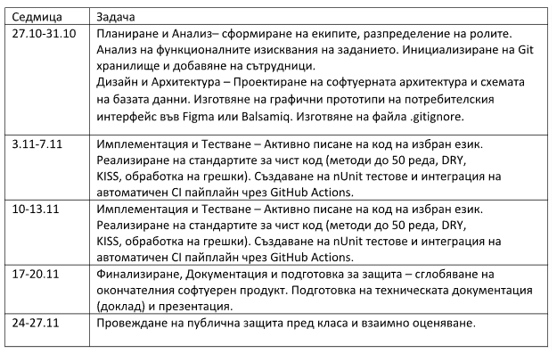

# 🎮 Каталог за компютърни игри (Задание No4 - Екип 4)

Уеб платформа, предоставяща подробна информация, каталогизация и оценки за компютърни игри.

## 📝 Описание на заданието
* **Функционални:** Всяка игра съдържа заглавие, студио, година, упътване, рейтинг, изображение, официални тагове, обяснение на съдържанието на български и линкове към легални магазини (Steam/Epic). Реализирани са търсачка по име, филтриране по студио и минимален рейтинг, сортиране по рейтинг или година, както и добавяне на игри през API (POST).
* **Нефункционални:** Адаптивен (Mobile-First) дизайн чрез CSS Grid. Lazy loading на изображенията (`loading="lazy"`). Поддръжка на кирилица (UTF-8, `utf8mb4`).

## 🛠 Технологичен стек (KISS)
* **База данни:** MySQL 8.0 (Docker)
* **Backend:** Node.js + Express + `mysql2` + `cors`
* **Frontend:** Vanilla JavaScript, HTML5, CSS3
* **Инфраструктура:** Docker Compose + Adminer

## 🚀 Стартиране

1. База данни и Adminer (инициализира се от `db/init.sql`):
   ```bash
   docker compose up -d
   ```
2. Backend (http://localhost:3000):
   ```bash
   cd backend
   npm install
   node server.js
   ```
3. Frontend (в нов терминал):
   ```bash
   npx serve frontend
   ```
   Отворете генерирания линк в браузъра.

## 🔌 API

| Метод | Адрес | Описание |
|-------|-------|----------|
| GET | `/api/games` | Всички игри (по рейтинг) |
| GET | `/api/games?search=witcher` | Търсене по име |
| GET | `/api/games?studio=Team Cherry` | Филтър по студио |
| GET | `/api/games?minRating=9.0` | Минимален рейтинг |
| GET | `/api/games?sort=year` | Най-новите първи |
| POST | `/api/games` | Добавяне (задължителни: `title`, `studio`) |

Параметрите се комбинират, напр. `?studio=Team Cherry&sort=year`.

## 📂 Структура
* `/db` - SQL скриптове за инициализация
* `/backend` - Node.js сървър и API
* `/frontend` - HTML, CSS и JS
* `docker-compose.yml` - Docker конфигурация

